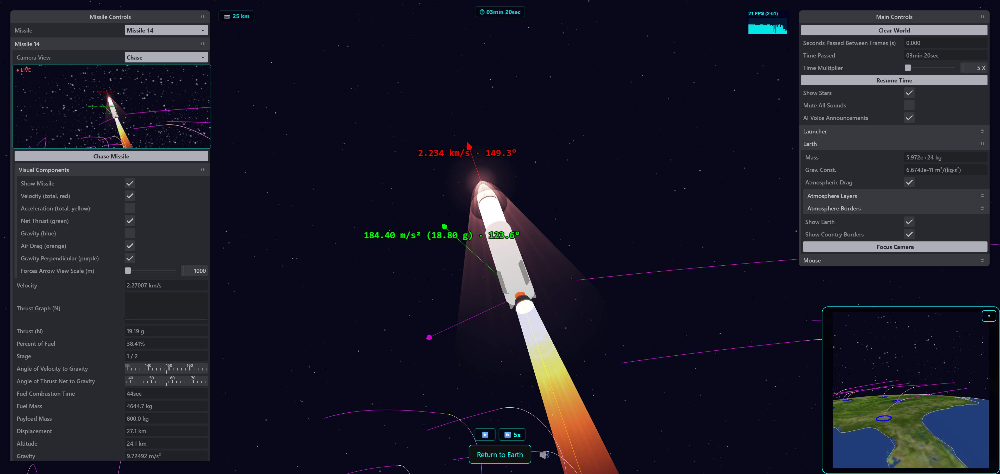

# Optimization Based ICBM Trajectory Calculator

This domain has moved.

New site: https://kichibayov.github.io/ballistic-missile-simulator/
The old URL (https://rally08.github.io/icbm-missile-simulator/) now redirects to the new site.

[Read more in post](https://www.linkedin.com/posts/azad-kichibekov_being-interested-in-celestial-mechanics-activity-7355349699991674880-07_Z?utm_source=share&utm_medium=member_desktop&rcm=ACoAADCbAJsBiOVo9nNBOFJFPRceoeeAywlV3o4)

## Contributing

Contributions are welcome, provided they follow a few guidelines to keep the project clean and maintainable:

* **Follow the existing architecture:** Please stick to the current code structure, patterns, and style. Pull requests that significantly alter the project's overall structure will not be accepted.
* **Document logic and structural changes:** If your contribution requires changing the structure or modifying existing core logic, it **must** be thoroughly documented (both in code comments and in your Pull Request description) explaining *why* the change is necessary and how it affects existing behavior.
